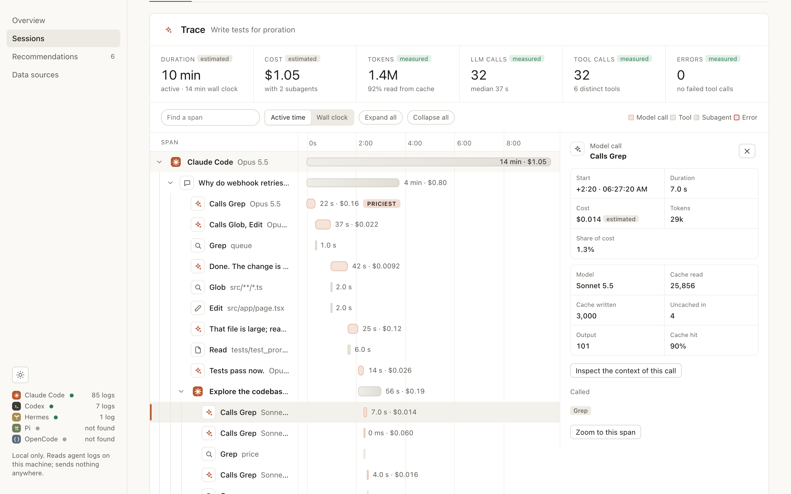
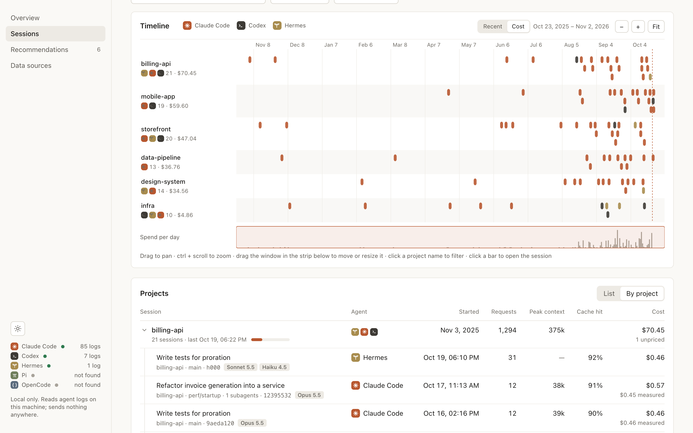
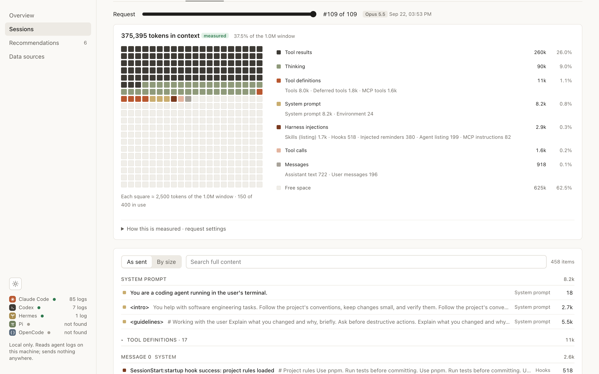
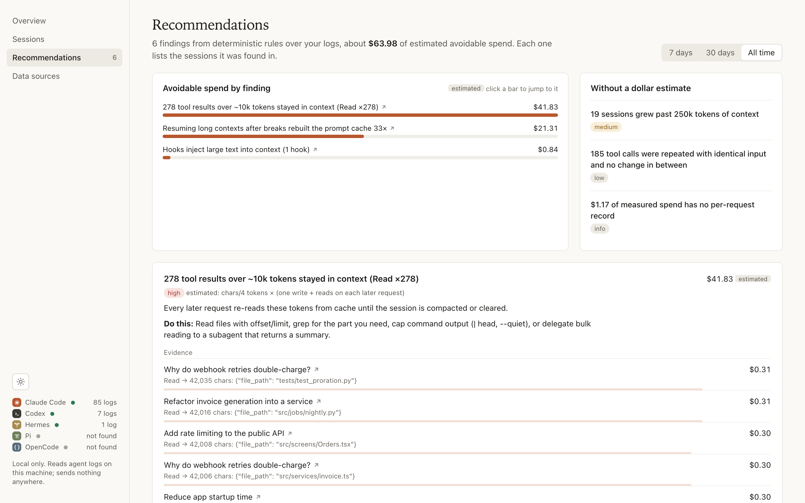
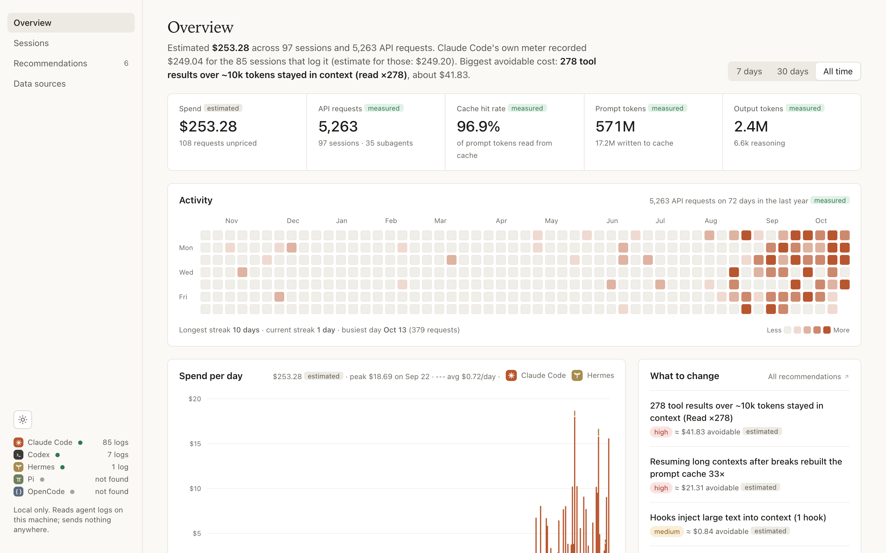

<p align="center">
  
</p>

<p align="center">
  <strong>See what your AI coding agents cost, and why.</strong><br/>
  <strong>Spend • Session traces • Context window • Recommendations</strong><br/>
  <sub>Reads the logs your agents already write. Local only, no dependencies, nothing leaves your machine.</sub>
</p>

<p align="center">
  <sub>Claude Code · Codex · Hermes · Pi · OpenCode</sub>
</p>

<p align="center">
  <a href="#install-in-claude-code">Install in Claude Code</a> · <a href="#ask-claude">Ask Claude</a> · <a href="#other-agents">Other agents</a> · <a href="#bonus-the-cli-underneath">The CLI underneath</a> · <a href="#privacy">Privacy</a>
</p>

# Agents Report

Agents Report is a **Claude Code skill** that tells you where your agents' tokens, money and time
went. Ask Claude *"why was that session so expensive?"* or *"what's filling my context?"*: it reads the
session logs already on your machine, opens the matching view of a local dashboard in your browser, and
answers with the numbers, ranked by cost, with the change to make.

It reads the logs of Claude Code, Codex, Hermes, Pi and OpenCode, so one report covers every agent you
use. Nothing leaves your machine.

> [!TIP]
> **Run `/agents-report` in Claude Code to open the dashboard.** It's the main way in: overview, sessions,
> traces, context window and recommendations, in your browser, with a short summary in the chat.

<table>
<tr>
<td width="38%" valign="middle">

### Trace every session

Every prompt, model call, tool call and subagent as a span tree on one clock, with duration and cost
per span. SLOWEST, PRICIEST and ERROR badges point at what to look at. Expand subagents inline, drag
to zoom, click a span for its tokens, cache hits and full input and output. Live while the session runs.

</td>
<td width="62%">



</td>
</tr>
<tr>
<td width="38%" valign="middle">

### See every session, by project

A timeline with a lane per project, sorted by recent activity or cost, and a spend-per-day strip you
drag to pan and zoom. Below it, every session across agents, flat or grouped by project, with subagent
cost rolled into its parent.

</td>
<td width="62%">



</td>
</tr>
<tr>
<td width="38%" valign="middle">

### Look inside the context window

For any past request, rebuild what the model actually read: system prompt, tool definitions, MCP
tools, loaded skills, hook output, tool results and messages, each with its share of the measured
token total. Search the full text of every item.

</td>
<td width="62%">



</td>
</tr>
<tr>
<td width="38%" valign="middle">

### Know what to change

Deterministic rules flag cache rebuilds after breaks, oversized tool results, hooks that inject large
text, expensive subagent models and more. Each one comes with evidence (session, request, measured
values), an estimated saving, and the concrete fix.

</td>
<td width="62%">



</td>
</tr>
</table>

<p align="center">
  
  <br/><sub>Overview: spend, cache efficiency, activity and spend per day across all agents. Screenshots use synthetic demo data.</sub>
</p>

---

## Install in Claude Code

```
/plugin install agents-report --marketplace viniciusestevam/agents-report
```

Then open the dashboard:

> [!IMPORTANT]
> ```
> /agents-report
> ```
> Opens the dashboard in your browser and summarizes your last 30 days in the chat. If another command
> already uses that name, use the full form `/agents-report:agents-report`.

Claude also uses the skill on its own when you ask about cost, tokens, context or a past session
([examples](#ask-claude)).

The one-line install needs Claude Code 2.1.275 or later; on older versions run
`/plugin marketplace add viniciusestevam/agents-report`, then `/plugin install agents-report@agents-report`.
Update with `/plugin marketplace update agents-report`.

The skill runs with the `python3` on your `PATH`, which must be 3.10 or later (`python3 --version`; the one
macOS ships is 3.9, so install a newer one with Homebrew or uv). Nothing else is needed.

<details>
<summary>Prefer a plain skill without the plugin?</summary>

Clone the repository and link the skill folder into `~/.claude/skills/`, so `git pull` keeps it current:

```bash
git clone https://github.com/viniciusestevam/agents-report ~/src/agents-report
ln -s ~/src/agents-report/.agents/skills/agents-report ~/.claude/skills/agents-report
```

Use `<project>/.claude/skills/` to install it for one project only. Keep the folder name `agents-report`:
it must match `name` in `SKILL.md`.

</details>

## Ask Claude

Start with `/agents-report`, or ask in plain language in any session:

| You ask | Claude runs | You get |
| --- | --- | --- |
| `/agents-report` | `dashboard`, then `brief --days 30` | The dashboard open on the overview, and a short summary of the last 30 days |
| "What did my agents cost this month?", "How do I spend less?" | `brief --days 30` | Total spend, cache hit rate and the top 3 recommendations, with the dashboard open on them |
| "Why was my last session so expensive?" | `explain latest` | Findings ranked by cost with request numbers, and what filled the context at the costliest call |
| "What's filling my context?" | `context latest` | The context window split by system prompt, tools, MCP, skills, hooks and messages |

```text
> why was my last session so expensive?

● Redesign the checkout flow cost $12.71, and 96% of that was its 4 subagents ($12.18).
  The main thread was only $0.54; its costliest request (#0) was $0.14 for 47k prompt tokens.
  Trace: http://127.0.0.1:48765/#/session/claude-code%3A4cde7517-…
```

Claude relays what the skill prints instead of doing its own arithmetic, and the skill's output is
deterministic: the same logs always give the same answer.

## Other agents

The skill follows the [agentskills.io](https://agentskills.io) format, so Codex and other agents that
read skills can use it too. Link the [`.agents/skills/agents-report/`](.agents/skills/agents-report)
folder into their skills directory:

```bash
git clone https://github.com/viniciusestevam/agents-report ~/src/agents-report
ln -s ~/src/agents-report/.agents/skills/agents-report ~/.agents/skills/agents-report
```

To copy it somewhere without git, build a zip from the clone with
`python3 .agents/skills/agents-report/scripts/agents_report.py package`.

## Bonus: the CLI underneath

Everything the skill does comes from one command-line tool bundled inside it,
[`agents_report.py`](.agents/skills/agents-report/scripts/agents_report.py): it parses the logs, ranks
the findings, writes the answers and serves the dashboard. The skill's instructions only tell Claude which
command answers which question. You never need to touch it, but you can run it yourself, for scripts,
CI, or when you'd rather not ask an agent.

To have it on your `PATH` as `agents-report`, install it with [uv](https://docs.astral.sh/uv/) or
[pipx](https://pipx.pypa.io):

```bash
uv tool install git+https://github.com/viniciusestevam/agents-report    # or: pipx install git+…
agents-report brief
```

Or try it once without installing:
`uvx --from git+https://github.com/viniciusestevam/agents-report agents-report brief`.

| Command | What it does |
| --- | --- |
| `brief [--days N]` | Spend, measured meter, cache hit rate, costliest session and the top 3 recommendations, plus the dashboard URL |
| `explain <session>` | Why one session cost what it did: findings ranked by cost, and what filled the context at its costliest request |
| `dashboard [--view V] [--session S] [--req N]` | Open the web UI. Views: `overview`, `sessions`, `recommendations`, `sources` |
| `sessions [--limit N]` | List sessions with cost, requests, cache hit rate and peak context |
| `show <session>` | One session's models, tokens, cost, cache rebuilds and large tool outputs |
| `context <session> [--req N]` | What one API request put in the context window, by contributor |
| `report [--days N] [--out file.md]` | Full Markdown report with recommendations and evidence |
| `recommend` | All recommendations |
| `doctor` | Which agents were found, parse errors, zstd support |
| `stop` / `serve` | Stop the background dashboard now / run it in the foreground |
| `package [--out file.zip]` | Zip the skill for installing in another agent (from a clone of the repository) |

Every command accepts `--json`. Filters: `--days N`, `--agent claude-code|codex|hermes|pi|opencode`,
`--project NAME`, `--here` (sessions started in the current directory). Name a session by its id prefix
(`4cde7517`) or `latest`. `--now 2026-10-01` (or `AGENTS_REPORT_NOW`) pins the clock for a reproducible
report "as of" a date. The dashboard server starts in the background, is reused across calls, and stops
by itself about 20 seconds after you close its last tab.

## Supported agents

| Agent | Logs read | Per-request detail |
| --- | --- | --- |
| Claude Code | `~/.claude/projects/` (or `CLAUDE_CONFIG_DIR`), including subagents | Yes, plus the exact request when logged, and Claude Code's own cost meter |
| Codex | `~/.codex/sessions/` and its thread database (`CODEX_HOME`) | Yes |
| Hermes | `~/.hermes/state.db` (`HERMES_HOME`), read-only | Token totals per model only |
| Pi | `~/.pi/agent/sessions/` (`PI_CODING_AGENT_DIR`) | Yes (from the published format, tested on fixtures) |
| OpenCode | `~/.local/share/opencode/opencode*.db` (`OPENCODE_DB`), read-only | Yes (from its source, tested on fixtures) |

Adding an agent means writing one adapter module: see
[references/adapters.md](.agents/skills/agents-report/references/adapters.md).

## How the numbers work

- **Tokens and timestamps are measured**, read straight from the logs. Claude Code writes several log
  lines per API response; each response is counted once.
- **Cost is estimated** as tokens × list price. Claude prices are Anthropic's published rates; the evals
  show they reproduce Claude Code's own meter to within 0.04%, and where the meter is logged it is
  shown next to the estimate.
- **Unknown prices stay unknown.** No OpenAI prices are bundled, so Codex cost shows as *unavailable*
  (never $0) until you add `~/.config/agents-report/prices.json`.
- **Savings are estimates** from logged tokens and current prices; their effect on output quality isn't measured.

Definitions: [metrics](.agents/skills/agents-report/references/metrics.md) ·
[recommendation rules](.agents/skills/agents-report/references/recommendations.md).

## Privacy

- Reads only the log folders above; SQLite stores are opened read-only.
- Makes no network calls. The dashboard binds to 127.0.0.1, rejects other `Host` headers, serves only
  its own files, and sets a strict Content-Security-Policy. The UI loads no external fonts, scripts or images.
- Transcripts can contain secrets. The skill tells agents to summarize rather than paste raw excerpts,
  and to ask before changing your configuration.

See [SECURITY.md](SECURITY.md) to report a vulnerability.

## Repository layout

```
.claude-plugin/marketplace.json   Claude Code marketplace (lists the plugin below)
.agents/skills/agents-report/     the plugin and skill: everything that ships
  SKILL.md                        instructions agents load
  .claude-plugin/plugin.json      plugin manifest
  scripts/                        CLI (agents_report.py) and the agentobs package
pyproject.toml                    the agents-report command package (code and UI from the skill folder)
  assets/ui/                      the dashboard: plain HTML, CSS and JS, no build step
  references/                     metrics, recommendation rules, adapter contract
tests/                            unit and integration tests on synthetic fixtures
evals/                            end-to-end checks against the real logs on your machine
tools/                            synthetic demo data and the screenshot recorder
docs/                             project state, decisions and eval history
```

## Contributing

Issues and pull requests are welcome. See [CONTRIBUTING.md](CONTRIBUTING.md): keep it dependency-free,
and run the tests and evals before opening a pull request.

## License

[MIT](LICENSE)
