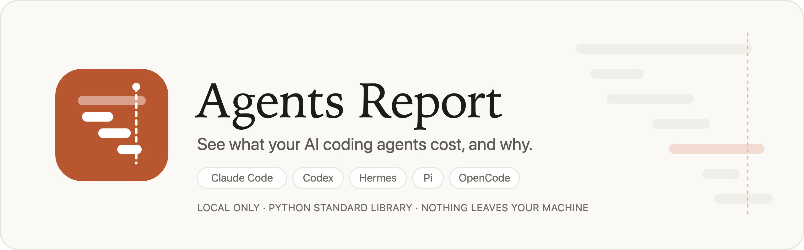

<p align="center">
  
</p>

<p align="center">
  <a href="LICENSE.txt"></a>
  
  
  
</p>

**Agents Report** reads the session logs your coding agents already write on your machine and shows
where the tokens, money and time went: what each session cost, what filled the context window, when
the prompt cache was rebuilt, which tool calls were slow, and what to change. It ships as a CLI, a local web
dashboard, and an Agent Skill and Claude Code plugin, so you can also just ask your agent *"why was
that session so expensive?"*

It works with **Claude Code, Codex, Hermes, Pi and OpenCode**. It uses only the Python standard library,
makes no network calls, and nothing leaves your machine.

## Contents

- [What you get](#what-you-get)
- [Install](#install): [Claude Code plugin](#as-a-claude-code-plugin-recommended) · [Agent Skill](#as-an-agent-skill-claude-code-codex-and-other-agents) · [CLI only](#as-a-standalone-cli)
- [Use it](#use-it)
- [CLI reference](#cli-reference)
- [Supported agents](#supported-agents)
- [How the numbers work](#how-the-numbers-work)
- [Privacy](#privacy)
- [Development](#development)

## What you get

- **Answers in one command.** `brief` summarizes spend, cache efficiency and the top recommendations.
  `explain <session>` tells you why one session cost what it did, with findings ranked by cost and tied to
  request numbers. The output is deterministic: the same logs always give the same text.
- **A local dashboard** at `http://127.0.0.1:48765`:
  - *Overview*: spend per day by agent, a GitHub-style activity graph, cache hit rate, top sessions.
  - *Sessions*: a timeline with a lane per project, sortable by recent activity or cost, with a
    spend-per-day strip you drag to pan and zoom. The list below it can be grouped by project.
  - *Session trace*: every prompt, model call, tool call and subagent as a span tree on one clock, with
    duration and cost per span, SLOWEST / PRICIEST / ERROR badges, zoom, a details panel, and live
    refresh while the session is still running.
  - *Context inspector*: rebuilds the exact API request Claude Code sent (system prompt, tool
    definitions, MCP tools, loaded skills, hook output, messages) and splits the measured token total
    across them. It works on any past request, not just the current one.
  - *Recommendations*: deterministic rules, each with evidence (session, request, measured values), an
    estimated saving, and the concrete change to make.
- **Honest numbers.** Every value is labelled *measured* (read from the logs), *estimated* (computed),
  or *unavailable*. Unknown prices show as a dash, never as $0.

## Install

Requirements: Python 3.10 or later. To read Codex's compressed logs you also need Python 3.14+ or the
`zstd` command-line tool.

### As a Claude Code plugin (recommended)

In Claude Code (2.1.275 or later), run:

```
/plugin install agents-report --marketplace viniciusestevam/agents-report
```

On older versions, add the marketplace first, then install:

```
/plugin marketplace add viniciusestevam/agents-report
/plugin install agents-report@agents-report
```

From your shell, the same thing is:

```bash
claude plugin marketplace add viniciusestevam/agents-report
claude plugin install agents-report@agents-report
```

Then ask Claude about your usage (see [Use it](#use-it)). To update later, run
`/plugin marketplace update agents-report`.

### As an Agent Skill (Claude Code, Codex and other agents)

This repository is itself the skill folder (`SKILL.md` at the root, in the [agentskills.io](https://agentskills.io)
format), so you can clone it straight into your agent's skills directory:

```bash
# Claude Code: all projects
git clone https://github.com/viniciusestevam/agents-report ~/.claude/skills/agents-report

# Codex and other agentskills.io agents: all projects
git clone https://github.com/viniciusestevam/agents-report ~/.agents/skills/agents-report
```

Use `<project>/.claude/skills/` or `<project>/.agents/skills/` instead to install it for one project.
Keep the folder name `agents-report`: it must match `name` in `SKILL.md`. Update with `git pull`.

Prefer a single file? Build a zip (no git metadata, caches or eval history) and unzip it where you need it:

```bash
python3 scripts/agents_report.py package          # writes agents-report.zip
unzip agents-report.zip -d ~/.claude/skills/
```

### As a standalone CLI

No install step: clone and run.

```bash
git clone https://github.com/viniciusestevam/agents-report
cd agents-report
python3 scripts/agents_report.py doctor           # which agents' logs were found
python3 scripts/agents_report.py dashboard        # open the web UI
```

Optionally put it on your `PATH`:

```bash
alias agents-report="python3 $PWD/scripts/agents_report.py"
```

## Use it

### Ask your agent

With the plugin or skill installed, ask in plain language. The agent runs one command, opens the right
dashboard view, and relays the answer:

| You ask | It runs |
| --- | --- |
| "What did my agents cost this month?", "How can I spend less?" | `brief --days 30` |
| "Why was this session so expensive?" | `explain latest` |
| "What's filling my context?" | `context latest` |
| "Open the agents dashboard" | `dashboard` |

### From the terminal

```console
$ python3 scripts/agents_report.py brief --days 30
Agent usage, last 30 days (as of 2026-10-22 20:54)
Dashboard: http://127.0.0.1:48765/#/recommendations
- Spend: $197.88 estimated across 32 sessions and 2,056 API requests.
- Claude Code's own meter measured $168.52 for the 25 sessions that record it (estimate for the same sessions: $159.49).
- Cache hit rate: 98% of prompt tokens were read from cache (measured).
Top recommendations:
1. [high] Resuming long contexts after breaks rebuilt the prompt cache 8× (about $11.45 avoidable, estimated)
   Do: Before a long break, finish the task or /compact. When you return, start a fresh session with a short handoff note instead of resuming a 100k+ token context.
...
```

```console
$ python3 scripts/agents_report.py explain latest
Redesign the checkout flow [4cde7517]
claude-code · shop-web · 2026-10-19 13:54 → 2026-10-19 14:19 · claude-opus-5-5 ×10
Cost: $0.54 estimated, $12.71 with its 4 subagents, $18.23 measured by the agent's own meter.

Findings, largest cost first:
1. 4 subagents cost $12.18, 96% of the session's total (estimated).
2. Costliest request: #0 (claude-opus-5-5), $0.14: 47,054 prompt tokens (30,987 read from cache, 16,065 written, 2 uncached) and 306 output.
...
```

The dashboard server starts in the background, is reused across calls, and stops by itself about
20 seconds after you close the last dashboard tab.

## CLI reference

Run `python3 scripts/agents_report.py <command>`. Every command accepts `--json`.

| Command | What it does |
| --- | --- |
| `brief [--days N]` | Spend, measured meter, cache hit rate, costliest session and top 3 recommendations, as finished text, plus the dashboard URL |
| `explain <session>` | Why one session cost what it did: findings ranked by cost, and what filled the context at its costliest request |
| `dashboard [--view V] [--session S] [--req N]` | Open the web UI (starts or reuses the background server). Views: `overview`, `sessions`, `recommendations`, `sources` |
| `sessions [--limit N]` | List sessions with cost, requests, cache hit and peak context |
| `show <session>` | One session's models, tokens, cost (estimated and measured), cache rebuilds and large tool outputs |
| `context <session> [--req N]` | What one API request put in the context window, by contributor |
| `report [--days N] [--out file.md]` | Full Markdown report with recommendations and evidence |
| `recommend` | All recommendations |
| `doctor` | Which agents were found, parse errors, zstd support |
| `stop` / `serve` | Stop the background server now / run it in the foreground |
| `package [--out file.zip]` | Zip the skill for installing in another agent |

Filters for the cross-session commands: `--days N`, `--agent claude-code|codex|hermes|pi|opencode`,
`--project NAME`, `--here` (sessions started in the current directory). Name a session by its id prefix
(`4cde7517`) or `latest`.

`--now 2026-10-01` (or `AGENTS_REPORT_NOW`) pins the clock, so a report "as of" a date is reproducible and
leaves out later sessions.

## Supported agents

| Agent | Logs read | Per-request detail |
| --- | --- | --- |
| Claude Code | `~/.claude/projects/` (or `CLAUDE_CONFIG_DIR`), including subagents | Yes, plus the exact request when Claude Code logged it, and its own cost meter |
| Codex | `~/.codex/sessions/` and its thread database (`CODEX_HOME`) | Yes |
| Hermes | `~/.hermes/state.db` (`HERMES_HOME`), read-only | Token totals per model only |
| Pi | `~/.pi/agent/sessions/` (`PI_CODING_AGENT_DIR`) | Yes (built from the published format, tested on fixtures) |
| OpenCode | `~/.local/share/opencode/opencode*.db` (`OPENCODE_DB`), read-only | Yes (built from the source, tested on fixtures) |

Adding another agent means writing one adapter module; see
[references/adapters.md](references/adapters.md).

## How the numbers work

- **Tokens and timestamps are measured**: they come straight from the agents' logs. Claude Code writes
  several log lines per API response; each response is counted once.
- **Cost is estimated** from tokens × list price. Claude prices are Anthropic's published rates
  ([pricing.py](scripts/agentobs/pricing.py), dated); the evals show they reproduce Claude Code's own
  cost meter to within 0.04%. Where Claude Code records its meter, the measured figure is shown next to
  the estimate.
- **No OpenAI prices are bundled**, so Codex cost (and any model without a known price) shows as
  *unavailable* until you add `~/.config/agents-report/prices.json` (format in
  [references/metrics.md](references/metrics.md)).
- **Savings are estimates** from logged tokens and current prices; their effect on output quality isn't measured.

Metric definitions: [references/metrics.md](references/metrics.md). Every recommendation rule, its
threshold and its fix: [references/recommendations.md](references/recommendations.md).

## Privacy

- Reads the log folders listed above; SQLite stores are opened read-only.
- Makes no network calls. The dashboard binds to 127.0.0.1, rejects other `Host` headers (DNS
  rebinding), serves only its own files, and sets a strict Content-Security-Policy. The UI loads no external
  fonts, scripts or images.
- Transcripts can contain secrets. The skill tells agents to summarize, not paste raw excerpts, and to
  ask before changing your configuration.

## Development

```bash
python3 -m unittest discover -s tests   # 41 tests on synthetic fixtures with hand-computed answers
python3 evals/run_evals.py              # 12 end-to-end checks against the real logs on this machine
```

The evals check, among other things, that every local log parses, that pricing reproduces Claude
Code's own meter, that unknown prices are never reported as $0, and that output is byte-identical
across runs. Method and history: [docs/EVALS.md](docs/EVALS.md). Project state, decisions and known
limitations: [docs/STATE.md](docs/STATE.md).

```
agents-report/
  SKILL.md                  instructions agents load (agentskills.io format)
  .claude-plugin/           Claude Code plugin and marketplace manifests
  scripts/agents_report.py  CLI entry point
  scripts/agentobs/         adapters per agent, store, analysis, context rebuild, pricing, server, CLI
  assets/ui/                the dashboard: plain HTML, CSS and JS, no build step
  references/               metric definitions, recommendation rules, adapter contract
  tests/  evals/  docs/
```

Contributions are welcome. Please run the tests and evals before opening a pull request, and keep the
code dependency-free.

## License

[MIT](LICENSE.txt)
